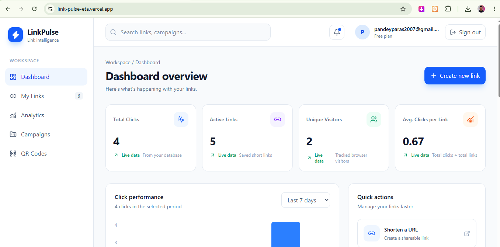
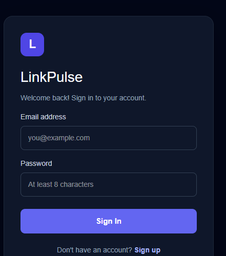
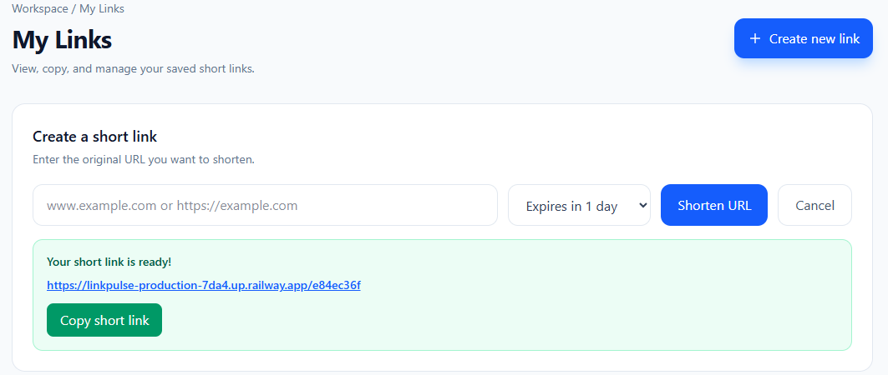
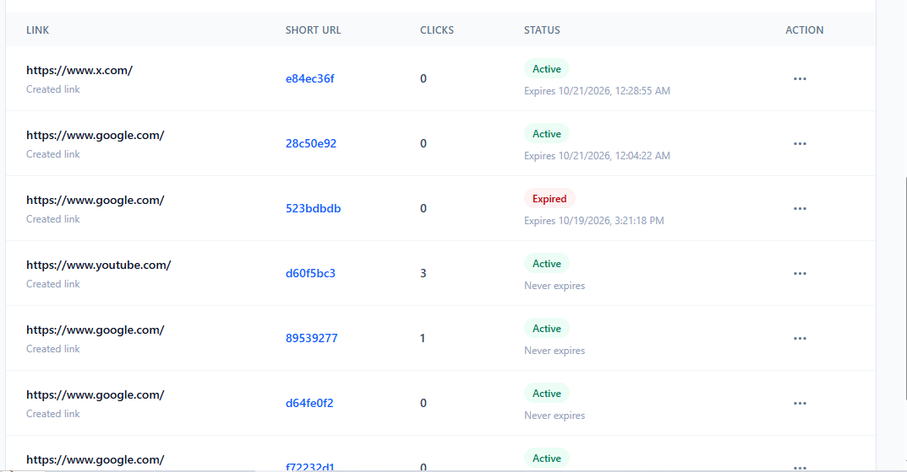
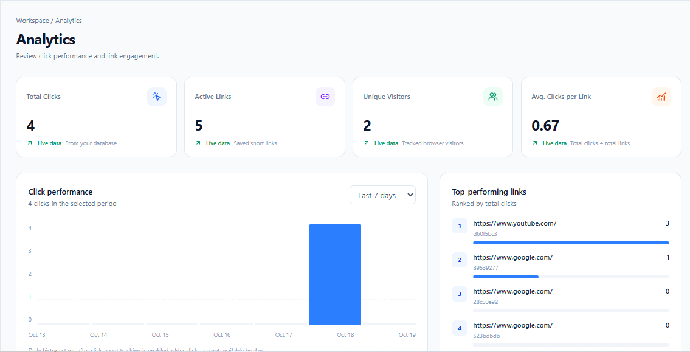
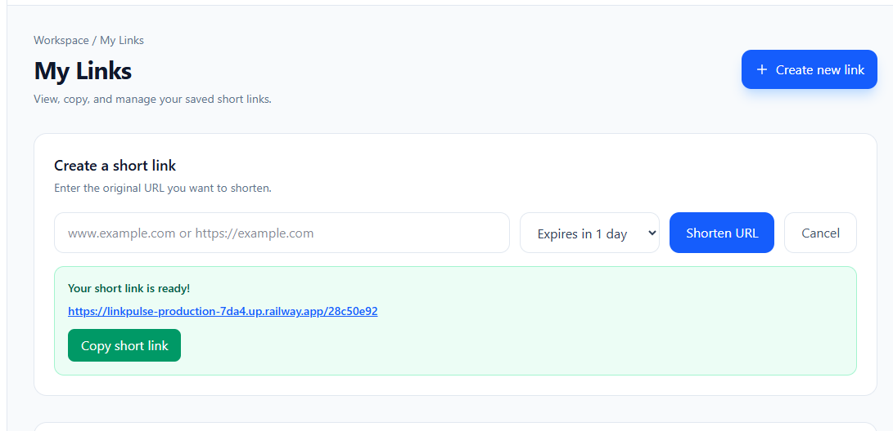

# LinkPulse — URL Shortener & Link Analytics

LinkPulse is a web-based URL shortening and link analytics platform that allows users to create short URLs, manage their links, and track link performance through an intuitive dashboard.

## Problem Statement

Long URLs are difficult to share, remember, and manage. Users also need a convenient way to monitor clicks and understand the performance of their shared links.

## Solution

LinkPulse simplifies URL sharing by converting long URLs into short links. It provides user authentication, link management, automatic redirection, and analytics to help users monitor link activity.

## Features

- **URL Shortening:** Generate short URLs from long links.
- **User Authentication:** Register and log in to access the platform.
- **Link Management:** View and manage created short links.
- **Click Tracking:** Track clicks on shortened URLs.
- **Analytics Dashboard:** View link performance statistics.
- **Unique Visitor Tracking:** Monitor unique visitors supported by the analytics implementation.
- **Automatic Redirection:** Redirect short URLs to their original destinations.
- **Responsive UI:** Access the interface on supported desktop and mobile screens.

## Tech Stack

### Frontend
- React
- Vite
- JavaScript
- HTML and CSS
- Tailwind CSS 

### Backend
- Node.js
- Express.js

### Database
- MySQL

### Deployment
- **Frontend:** Vercel
- **Backend:** Railway
- **Database:** Railway MySQL

## Live Demo

- **Live Website:** https://link-pulse-eta.vercel.app/
- **Backend API:** https://linkpulse-production-7da4.up.railway.app/

## Screenshots

### 1. Dashboard


### 2. Login Page


### 3. URL Shortening


### 4. My Links


### 5. Analytics Dashboard


### 6. Additional Screenshot


## Setup Instructions

### Prerequisites
- Node.js and npm
- Git
- MySQL database

### 1. Clone the Repository

```bash
git clone https://github.com/paraspandey215/LinkPulse.git
cd LinkPulse
```

### 2. Install Frontend Dependencies

From the project root, run:

```bash
npm install
```

### 3. Install Backend Dependencies

```bash
cd server
npm install
```

### 4. Configure Environment Variables

Create a `.env` file in the backend folder and configure the environment variables required by the application, including database connection settings and a secure session secret.

Do not upload passwords, database credentials, or other secrets to GitHub.

### 5. Start the Backend

From the `server` directory, run the start script configured in `server/package.json`. For example, if a `dev` script exists:

```bash
npm run dev
```

### 6. Start the Frontend

Open a second terminal in the project root and run:

```bash
npm run dev
```

Open the local URL shown in the terminal, usually `http://localhost:5173`.

## Project Structure

```text
LinkPulse/
├── public/
├── server/
│   ├── routes/
│   └── server.js
├── src/
├── screenshot/
├── package.json
├── package-lock.json
└── README.md
```

*This is a simplified overview; the repository may contain additional files.*

## Future Enhancements

- More detailed link analytics and reporting
- Additional link management options
- Improved analytics visualizations

## Contributors

Developed as a collaborative team project.

## License

No license has been specified yet. Add a license if the project is intended for open-source distribution.
